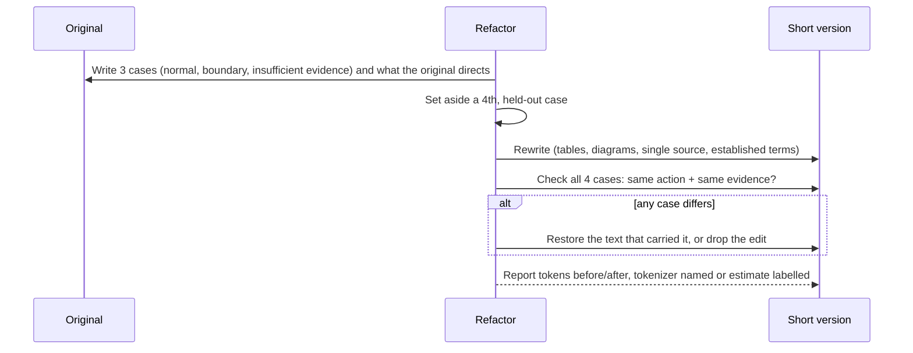

# Doc Refactor

## Goal

Refactor a document so it is easier to act on, with no information loss:

- Live feature prose: remove bloat (records are left as they are)
- Functional documents (instructions that are loaded and executed): keep every decision the same — being shorter is a by-product, never the target

## Standard by Document Class

| Class | Files | Standard |
|-------|-------|----------|
| Live feature prose | `docs/features/**` documents whose role is Current authority — they state what is true now | Prune what is dead, merge what is duplicated, split what remains (`rules/docs-numbering.md` § Size Limit) |
| Record | Request tickets, review logs, ADRs — what was decided or done at a point in time | **Not pruned, merged, split or rewritten.** Fix formatting only; a superseded decision stays |
| Other prose | Any other `.md` (`CONTRIBUTING.md`, a guide) | Preserve content; tables and diagrams where they help. No line budget |
| Functional document | `skills/**`, `agents/`, `commands/`, `rules/*.md`, `CLAUDE.md`, templates, fixtures | **No line budget.** Decision fidelity, below |

For a document under `docs/features/` the role decides, not the filename — a `2-tech-spec.md` can
be a design record. Role unknown → treat it as a record (formatting only) and say so.

## Decision Fidelity

A reader following the short version must reach the same action, with the same evidence, as a
reader following the original.



## Techniques

| Before | After |
|--------|-------|
| Long paragraphs | Table comparison |
| Step-by-step lists between actors | sequenceDiagram |
| Repeated information | Single source + reference |
| A concept re-explained at each use | An established term, only where it replaces the repeated text |
| Too many examples of one point | 1 example that covers the boundary |

## Output

```markdown
## Refactoring Summary
- Document class: <live feature prose | record | other prose | functional document>
- Input tokens: X → Y (tokenizer: <name>, or "estimate: <method>")

## Decision Fidelity (functional documents)
| Case | Original directs | Short version directs | Same? |
|------|------------------|-----------------------|-------|
| Normal / Boundary / Insufficient evidence / Held-out | ... | ... | Yes / No |

## Major Changes
- <what was consolidated; what was restored after a failed case>
```

## Constraints

- Never trade away hard conditions, exceptions, handoff data or permissions (frontmatter and `allowed-tools` included)
- No deleting key information
- No changing document purpose
- Line count is not a goal and not a measure; report tokens, with the tokenizer named or the estimate labelled
- A rewrite that fails any case is restored, however much shorter it was
