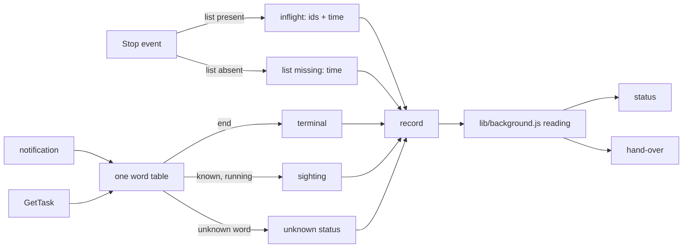

# agentctl-background-status Technical Spec

> **Requirements**: [1-requirements.md](./1-requirements.md) · **Intent**: [intent-agentctl-background-status.md](./intent-agentctl-background-status.md) · **Parent spec**: [agent-control-plane-mod](../agent-control-plane-mod/2-tech-spec.md)
> **Created**: 2026-11-25

## 1. Requirement Summary

- Problem: `Background in flight: N (ids)` merges what the host listed with what only started, without
  time or source, and a missing host list is stored as an empty one.
- Goals: FR-1 to FR-12 in `/agentctl`, `--details` and the hand-over. The mod stays optional; agentctl 0.4.0.
- Scope: `mods/agentctl` only.

## 2. Existing Code Analysis

- `lib/reducer.js`: `tool.end`, `background.inflight`, `background.terminal`, `evaluateStall`.
- `hooks/register.js`: `classic.Stop` turns a missing `background_tasks` into `[]`; `GetTask` closes on any
  status but `working`; `lib/notices.js` accepts four words.
- `lib/view.js` and `lib/handoff.js` render separately. The saved state is per session and has no version.

## 3. Technical Solution

### 3.1 Architecture

### 3.2 Data

Per record, added beside today's `status`, `since`, `asOf`, `opId`, `endedAt`, and only when they apply:
`queriedAt` with `queriedVia` (notification or task query), `word` with `wordAt` (sanitized), `seenAgainAt`,
`conflict`, and `ctx` (the load of the session that last saw it). Per session: `bgList = { suppliedAt, ids,
later, missingAt }` — the latest supplied list by its ids, the ids with newer evidence than it, and whether
a later event carried no list. With saved ids, membership never comes from equal times. State saved by
0.3.1 has only times and reads as from before: an item's own last listing is kept, a later list that named
another id shows its absence, and whether it was in the latest list stays unknown. Nothing is migrated.

### 3.3 Rules

| Event | Rule |
|---|---|
| `Stop` with a list | Listed ids get `asOf`; `bgList` is replaced, even by an empty list |
| `Stop` without a list | Only `bgList.missingAt`; no record changes |
| Start seen after an end for the same id | The end stands; the operation is linked and closed with it |
| Same end again | No change |
| A different end | Kept as conflicting; neither is dropped, evidence is not marked passed |
| Unknown word, either path | Stored for a held record without an end. An id never held gets no record. A record ended and not named again keeps no word; one named again does. Never an end itself |
| A supplied list, a `working` notification or a `working` task query names an id after its observed end | It reads "ended at T1, named again at T2" and is open. The end is not undone; the host resumes background agents under the same id (seen in a notification's own text). A later end then belongs to that new sighting and is not a conflict. A check that had passed is unverified again until that end; one that had failed never becomes a pass. A start linked meanwhile closes neither the operation nor the check |

`lib/background.js` turns records into readings, used by status and hand-over:

| Reading | When |
|---|---|
| listed | In the latest list, and no later event lacked one |
| working | A notification or task query said so since the latest list; the path is named |
| not in the latest list | Absent from its ids, with no newer evidence |
| started, not listed since | No `asOf` |
| last listed, later unknown | The latest `Stop` carried no list |
| unknown status word / conflicting ends | As named |
| ended, named again | An open record with an end and nothing newer than that sighting. A newer list without it, or an unknown word, becomes the reading, and the end and the sighting stay as history. A kept unknown word takes precedence over a later list without the id; `--details` then shows both |
| from before the reload | `ctx` is another load's; the last reading keeps its source and time and is marked, until seen again |

### 3.4 Display

- Compact status: at most two lines — what the host named (its list, a `working` report, or a sighting
  after an end) with the newest age, and the rest with the oldest age: a count with completion unobserved
  and a separate count with conflicting ends. The first count is not the size of the host's list;
  `--details` gives each item its id, its sanitized command when observed, reading, source and age.
- No items: nothing in compact; `--details` says nothing was observed and untracked work cannot be
  confirmed.
- When an open record keeps the stall hint from being evaluated and the session has been quiet for the
  stall time, `--details` says so. The hint's rule itself does not change.

## 4. Risks and Dependencies

| Risk | Mitigation |
|---|---|
| A tidy count by dropping items | Nothing is closed or hidden by age or absence |
| Saved state from 0.3.1 | Missing fields read as unknown; tested |
| Host reuses an id | Only a later host sighting (list, `working` notification or query) reopens an ended id; a later start record alone never does |
| Evidence tied to a conflicting end | Evidence keeps its first outcome only if the ends agree; otherwise it reads conflicting and is not "verified" |

## 5. Work Breakdown

1. Reducer, notices, register. 2. `lib/background.js`, view, hand-over. 3. Tests, README, 0.4.0 lock.

## 6. Testing Strategy

Reducer tests per rule, reading tests for UC-1 to UC-13, flow tests through the registered hooks (list
present, list absent, notification, `GetTask` unknown word, reorder), 0.3.1 saved state, sanitized
output, both hosts 2.1.289 and 2.1.332.

## 7. Open Questions

- Which words and orders the host sends, and whether its list is complete: unverified.
