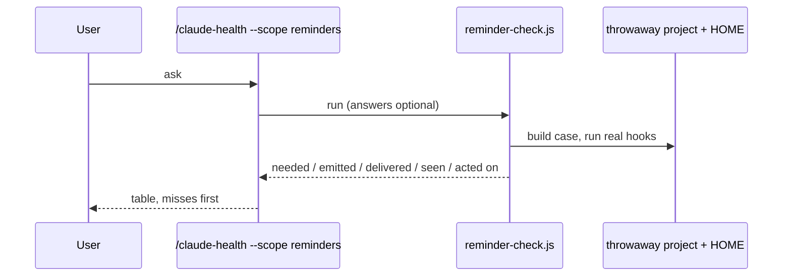

# hook-reminder-value Technical Spec

> **Requirements**: [1-requirements.md](./1-requirements.md) · **Intent**: [intent-hook-reminder-value.md](./intent-hook-reminder-value.md)
> **Created**: 2026-11-25

## 1. Requirement Summary

- Problem: only "printed" is observable, and it is read as "useful".
- Goals: an on-demand check that runs the real reminder hooks on synthetic cases, reports the four stages
  apart, and finds a missing needed reminder.
- Scope: `/claude-health --scope reminders`, on request only. No hook, rule or registration changes.

## 2. Existing Code Analysis

- `hooks/*.sh` and `scripts/namespace-hint.sh`: run as plain commands with `HOME`, `CLAUDE_PROJECT_DIR` and
  `CLAUDE_PLUGIN_ROOT`; the tests already do so.
- `skills/claude-health`: modules chosen by `--scope`; read-only reports.
- `scripts/review-state.js` `computeOffer`: an unreadable plane is always required and answers
  `gates-open`, so no state there reads as already shown. It stays unchanged.

## 3. Technical Solution

### 3.1 Architecture

### 3.2 `skills/claude-health/scripts/reminder-check.js`

Runs the reminder hooks of the loaded plugin by default, in a temporary directory with its own `HOME`. The
diagnostic itself uses `git init` there, never `git add` or `commit`, reads no transcript and no project
file, directs its fixtures and review state there, and removes the directory. Options: `--plugin-root`,
`--seen <hook>=yes|no|unknown` (the user's answer), `--format=md|json`, `--formatter <prettier>`.
`--plugin-root` and `--formatter` name code that will be run as the user: both are trusted inputs, and the
diagnostic does not confine what that code does.

| Case | Needed | Expectation |
|---|---|---|
| edited, nothing noted | yes | Fact line shows `code_review` and `precommit` open; `Stop` lists both |
| same again | no new need | Same output is reported as a repeat, not as waste |
| all passed | no | No owed line |
| edited after pass | yes | Both read stale; `Stop` lists both |
| compaction | yes | Baseline and both gates present |
| nothing changed | no | No owed line |
| bypass set | no, by choice | The four review reminders are silent; the namespace hint still prints |
| state unreadable | yes ("unknown") | At least one reminder says so; never `change=none`, never an offer. Silence is a miss |
| menu marked shown | no | No offer line at unchanged content. Whether the owner answered is not part of the case |
| owed across five turns, then a compaction | yes | Both gates present at the end and after it |
| after a Skill | no state needed | The fixed line, the same each time |

UC-6 (the `🧭` line, whose one chance per session is spent when printed) is a paper case: whether anyone saw
it is not observable here, and the hook's own tests cover the printing.

Stages: **emitted** is measured. **delivered** is kept in two: the host's documented *route* for the event
(`documented` / `not documented`, with the page named), and *receipt* by the model, which no synthetic run
observes and is always `unknown`. **seen** is the user's answer or `unknown`. **acted on** is always `unknown` here.
Exit 1 only when a needed reminder is missing; repeats never fail.

The formatter is timed only when asked, in its own section, and appears in no reminder verdict. Without a
given prettier it reports that formatting time was not measured.

## 4. Risks and Dependencies

| Risk | Mitigation |
|---|---|
| A frequency figure becomes a reason to trim | The report prints no "waste" verdict and states what repetition restores |
| Running hooks has side effects | Temporary directory and `HOME` for the plugin's own hooks; the guards are never run. Code named by an option is the user's choice |
| The documented route differs by host version | Printed as documented, with the page's address |

## 5. Work Breakdown

1. Script and skill module. 2. Tests.

## 6. Testing Strategy

`test/scripts/reminder-check.test.js`: every case above; a mutated hook that stops printing, or drops one
of two owed gates, makes the run exit 1 and name the miss; a repeat does not; real `HOME` and project untouched; no transcript access in the
source; answers shown as given; formatter section separate.

## 7. Open Questions

- Whether a person sees `Stop` lines, and whether any reminder changes behavior: unverified by design.
