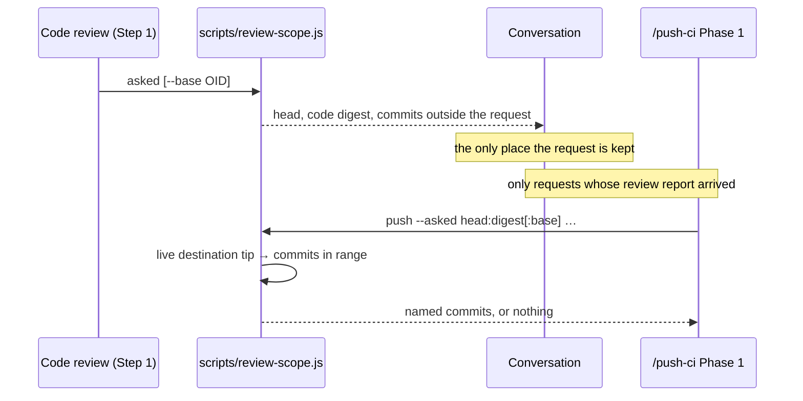

# review-coverage-visibility Technical Spec

> **Requirements**: [1-requirements.md](./1-requirements.md) · **Intent**: [intent-review-coverage-visibility.md](./intent-review-coverage-visibility.md)
> **Created**: 2026-11-25

## 1. Requirement Summary

- Problem: "gates passed" says what the automated offer may do, and is read as "someone reviewed what I
  am sending".
- Goals: say what an identified review was asked about, name the commits outside it, and claim nothing
  without evidence (FR-1 to FR-7).
- Scope: code plane, interactive, same conversation, nothing stored. Two surfaces: the code review report
  and the `/push-ci` plan.

### Decisions on the requirements' open questions

| Question | Decision |
|---|---|
| Which surface | Both, with different noise levels. The review report prints the reader's sentences once, when it ran (§ 3.4) and the user has not asked to omit them in this conversation. The push plan speaks **only when a commit can be named** |
| "Unknown" at push | Not volunteered (owner, 2026-11-25: of no use alone). `--all` answers it on request with two separate statements — what `review-state.js check` records, and the requested scope; a record whose match cannot be shown reads "not shown to match", never "different" — so the intent's new-conversation sketch is met on demand; the intent is unchanged |
| Building before the reader check | Owner's decision, 2026-11-25. It is not reader evidence: the paper check stays undone and its stop rules apply to the first slice |
| Local or live range | The push reading asks the push destination itself. Without an answer the range is unknown and nothing is named |

## 2. Existing Code Analysis

- `scripts/lib/tree-digest.js`: `computeTreeState` (code-plane digest of the work tree) and `digestOfRev`
  (the same digest of a commit). Their equality proves a commit holds the content that was in the tree.
- `scripts/review-state.js` `publishAhead`: the destination rules to follow (one push URL, refuse a second
  `insteadOf` rewrite, live tip must be an ancestor). Eligibility code stays untouched.
- `skills/codex-code-review/SKILL.md` Step 1 freezes the request; Step 4.5 reports the verdict.
- `skills/push-ci/SKILL.md` Phase 1 plan. The whole document is digest-pinned.

## 3. Technical Solution

### 3.1 Architecture

### 3.2 `scripts/review-scope.js`

Read-only. It writes nothing, and reads the network only in `push` (one `ls-remote` per invocation).

| Command | Output |
|---|---|
| `asked [--base <oid>]` | One `[REVIEW_REQUEST] <head>:<digest\|unknown>[:<base>]` line, then one plain sentence: what was requested and which local ahead commits are outside it, by short id |
| `push [--asked <head>:<digest>[:<base>]]… [--all] [--format=md\|json]` | `md`: only lines that name commits. `--all` adds the unknown ones and their reason. `json`: everything. Without a request the quiet form asks nobody; past 200 commits the range is unknown and nothing is read per commit |

`asked` printing `[REVIEW_REQUEST] 1a2b…:sha256:9f…` pairs with `push --asked 1a2b…:sha256:9f…`: the value is
the text after the space, unchanged.

### 3.3 Classification

For a commit `c` in the range the destination lacks, and each identified request `(b, H, D)`, with `b` the
base given or `H`:

| Reading | When |
|---|---|
| docs-only | `c` changes no code-plane path |
| outside | `c` is `b` or an ancestor of `b`; or the requested net change is established and contains none of `c`'s code paths |
| asked about | A commit `e` at or after `c` has code digest `D`, `b..e` is linear, and every code path `c` changes goes in `c` itself from exactly what `b` holds to exactly what `e` holds. A step in between (`old` → `temporary` → `final`) was never in the request, so both commits read unknown |
| unknown | Anything else, merges included |

Across requests: *asked about* if any says so; *outside* only if at least one request is identified and
every one excludes it; otherwise *unknown*. "Covered" is never printed: nothing here shows what a reviewer
read. No requests given means every commit is unknown.

Same digest and same paths prove that the published content equals the content in the tree when the
request was made. An edit reverted during the review stays invisible; that is the requirements' conditional
question, not a claim here.

### 3.4 Skill text

- `codex-code-review` Step 1 runs `asked` after the tree is settled and before dispatch, and only when the
  frozen list names every code path changed in the tree: the reader reads the whole tree and cannot stand
  for a narrower dispatch. Step 4.5 prints its sentences with the verdict, once,
  unless the user asked in this conversation to omit them, and keeps the line for the push plan. A failure to run prints nothing and
  never affects the gate.
- `push-ci` Phase 1 gains one optional plan line fed by `push`. It is omitted when the command prints
  nothing, or when an earlier plan in the conversation already showed the same statement. It authorizes
  nothing and changes no question.

## 4. Risks and Dependencies

| Risk | Mitigation |
|---|---|
| "asked about" read as "covered" | The sentence says what was requested and that reading is not verified |
| Noise on multi-commit branches | Nothing is printed unless a commit is named; a commit reviewed in its own turn is *asked about* when its request line is at hand |
| A compaction loses every request line | Every reading is unknown and the push plan says nothing |
| A compaction keeps some request lines | "Outside" is said of the surviving requests only, with their number; earlier review stays not known |
| Destination unreachable | Range unknown; nothing named |
| A branch the destination lacks | The range is labelled as counted from the default branch (`range: default-branch`), and what the push adds reads not known, whatever the commits read; a commit may be on another destination branch |
| Cost of a long range | The number of git commands is linear in the range and the requests, never in pairs; past 200 commits nothing is read per commit |
| A tree that cannot be read whole | No file count and no digest; nothing positive follows |

## 5. Work Breakdown

1. `scripts/lib/review-scope.js` (pure classification) and `scripts/review-scope.js` (git and CLI).
2. Skill text in `codex-code-review` and `push-ci`, with the push-ci digest re-pinned.
3. Tests.

## 6. Testing Strategy

`test/scripts/review-scope.test.js`, real temporary repositories, UC by UC: single commit, split commits,
older ahead commit, three requests, no request, wrong digest, commit and revert, branch base, merge,
docs-only, a step the request never held, a branch at the default tip, a commit on another destination
branch, different slot states under `--all` (an unreadable
tree among them), git command count, missing and unreachable destination, upstream that is not the destination, two push URLs.
Guards both ways: a changed byte after the request turns *asked about* into *unknown*.
`test/skills/review-scope-text.test.js`: both skills state the rules above. Existing eligibility tests
unmodified.

## 7. Open Questions

- Field benefit and the paper check are unverified; the requirements' stop rules still apply.
