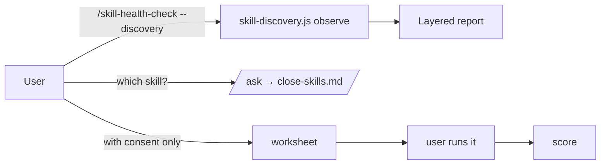

# skill-discoverability Technical Spec

> **Requirements**: [1-requirements.md](./1-requirements.md) · **Intent**: [intent-skill-discoverability.md](./intent-skill-discoverability.md)
> **Created**: 2026-11-25

## 1. Requirement Summary

- Problem: no agreed way to say whether a skill was not listed, not described or not chosen.
- Goals: make step 1 of the requirements (§ 8) usable from an existing skill, make step 2 ready without
  running it, and help a user tell close skills apart. Descriptions do not change (`INV-003`).
- Scope: `/skill-health-check --discovery` and `/ask`.

## 2. Existing Code Analysis

- `skills/skill-health-check`: lint of one skills directory. Its description-overlap check is a word
  measure that misses parent/alias pairs.
- `skills/ask/references/routing-table.md`: suggests, never redirects. Eight signals, no close pairs.
- `test/skills/alias-skills.test.js` pins aliases. `CLAUDE_PLUGIN_ROOT` names the loaded plugin.

## 3. Technical Solution

### 3.1 Architecture

### 3.2 `skills/skill-health-check/scripts/skill-discovery.js`

| Command | Reads | Prints |
|---|---|---|
| `observe --plugin-root <dir> [--project <dir>] [--home <dir>] [--listed N --described N --method doctor\|context\|self-report] [--install ordinary\|checkout\|unknown] [--name-only a,b] [--reached a=explicit,b=described]` (each value is `name=explicit\|described\|unknown`) | This plugin's `SKILL.md` frontmatter, and only same-named entries under the project's and the user's `.claude/skills` | One row per layer with its source, then the § 8 verdict |
| `worksheet [--seed N] [--lang en\|zh]` | `references/discovery-phrases.json` | Shuffled phrases without answers. One language still includes the explicit controls, which are commands and belong to both |
| `score --answers <file>` | The same file and the recorded answers | Hits, missed, wrong and unwanted as separate counts, per condition; never one figure |

No model call, no network, nothing written. Names of other plugins or skills are never read out: the
project and user folders are looked up by this plugin's own names.

**Layers.** *Installed*: measured. *Listed* and *Described*: only what the user passes, with the method;
otherwise `unknown`. *Selected*: `not tested`. *Explicit*: the literal `/sd0x-dev-flow:<name>` form.
*Duplicates*: per source, and whether the copy is the same real directory (a link) or another copy. A
plugin root inside the project is a source checkout whatever is claimed. Elsewhere a path cannot show how
the plugin was installed: without `--install ordinary` from the user there is no ordinary-install verdict.

### 3.3 Phrases

Each entry has an id, language, phrase, `accept` (a set, so equivalent skills count alike; empty for a
no-skill control) and a kind (`target`, `none`, `explicit`). At least as many `none` as `target` entries.
Answers are committed before any run.

### 3.4 Close skills

`skills/ask/references/close-skills.md` lists groups that a description alone does not separate, with one
distinguishing question each. `/ask` consults it when a request fits more than one skill, and still only
suggests. It states that an alias reaches the same workflow.

## 4. Risks and Dependencies

| Risk | Mitigation |
|---|---|
| A count is read as selection quality | The selection row always reads `not tested` |
| A self-reported list is taken as fact | The method is printed beside the number |
| Phrases leak their answer by wording | Checked in tests for `target` phrases; an explicit control is the command itself |
| Resident cost | No description, rule or hook changes |

## 5. Work Breakdown

1. Script, phrases, skill text. 2. `close-skills.md`, `/ask` pointer. 3. Tests.

## 6. Testing Strategy

`test/scripts/skill-discovery.test.js`: ordinary install, source checkout with a linked folder, separate
copy with the same name, unreadable folder reported as not checked, missing numbers, every § 8 row, other
skills' names never printed. Scoring: equivalent sets, unwanted use counted alone, unanswered phrases.
Each language's worksheet holds targets, no-skill phrases and explicit controls.
`test/skills/skill-health-check.test.js` and `ask.test.js`: entry points and names that exist. That no
`description` changed is a separate review check: `git diff <base> -- 'skills/*/SKILL.md'` shows no changed
`description:` line. No test pins it, since later features may change descriptions.

## 7. Open Questions

- Whether an ordinary install truncates, and whether that affects selection: unverified by design.
